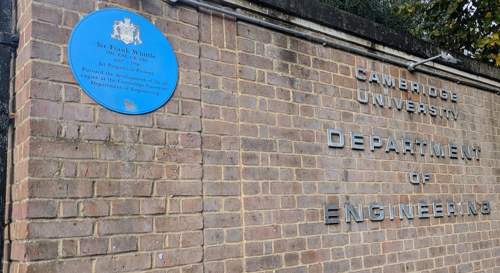
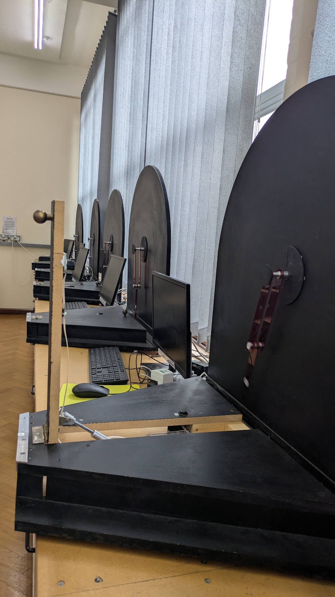
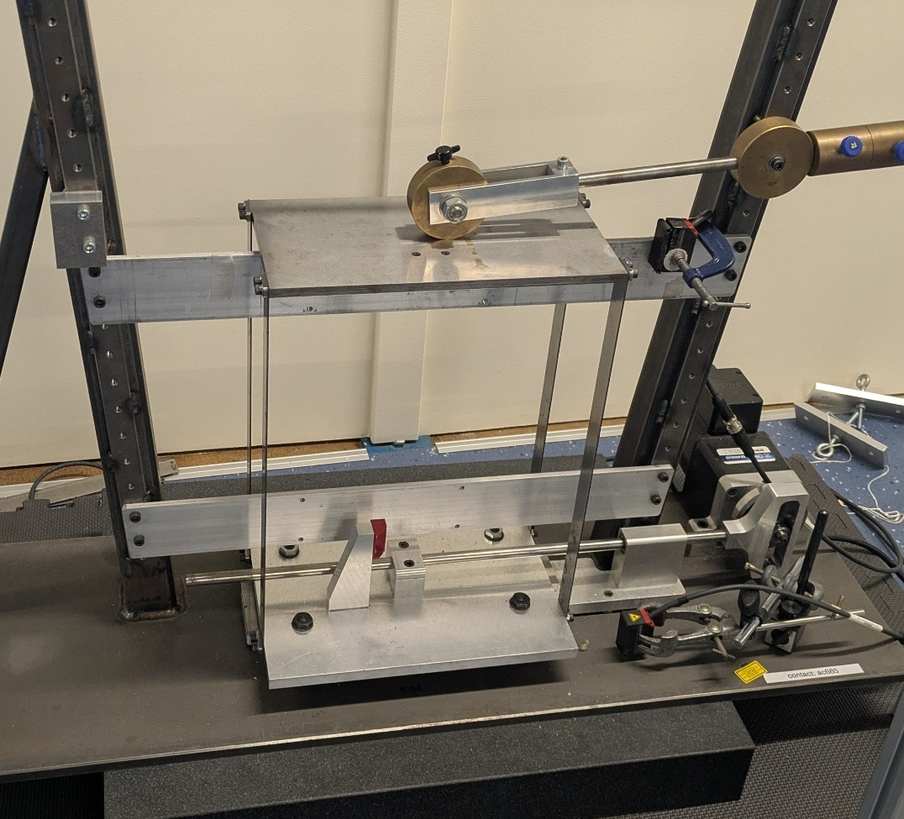
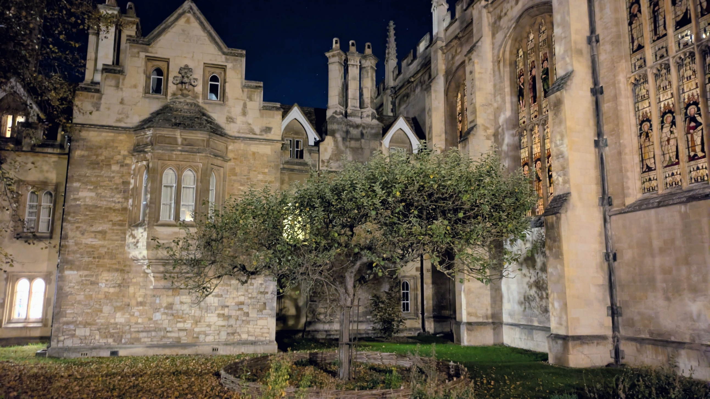
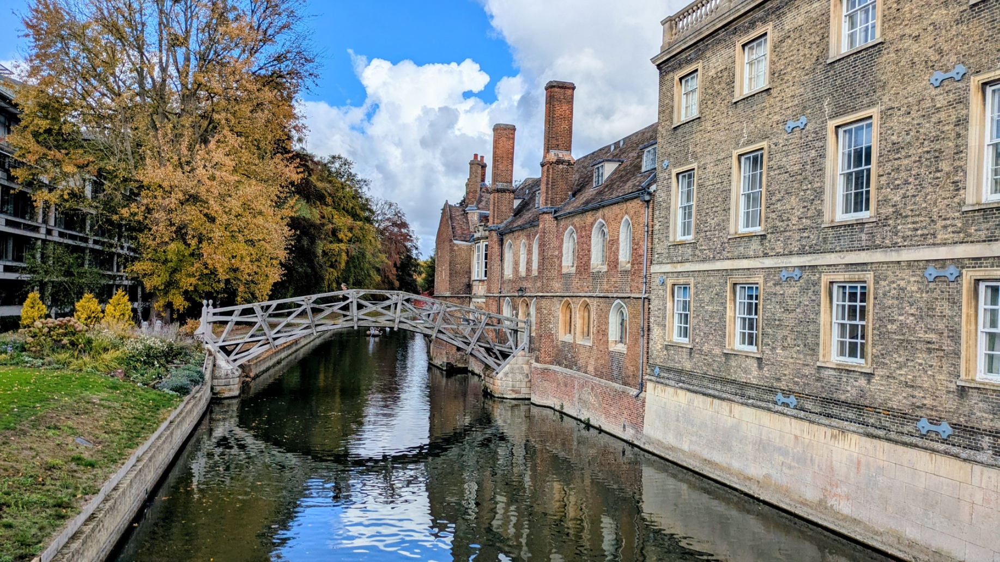
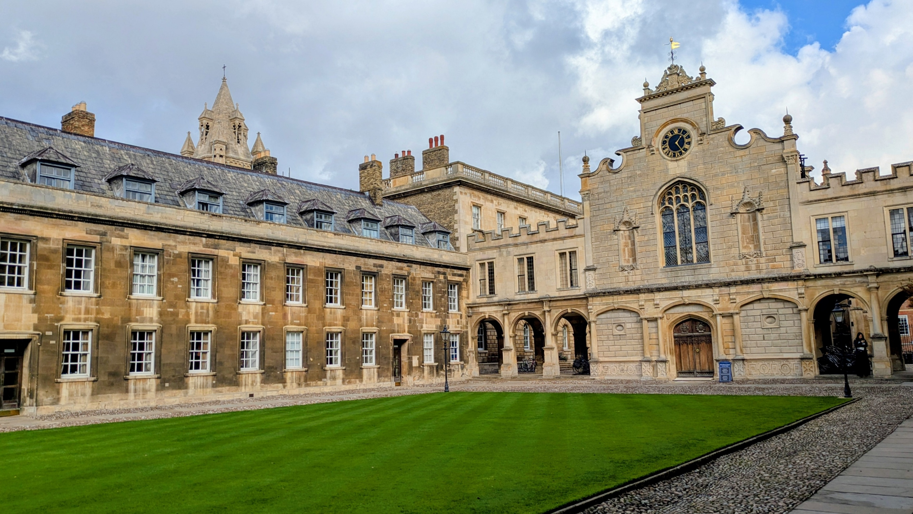

Last Friday, I had the opportunity to give a seminar talk for the [Data, Vibration and Uncertainty Group](https://sites.google.com/view/dvugroup/) at the University of Cambridge’s Department of Engineering.

I presented my work on symbolic regression and equation discovery, focusing on its applications for dynamical systems identification. It was great to connect with researchers working on interesting engineering problems using different physics-enhanced ML techniques and exchange ideas on where these methods can be applied.

Thank you, [Alice Cicirello](https://sites.google.com/view/dvugroup/people/dr-alice-cicirello), for the invitation and for having me as your guest. It was a privilege to visit the department and experience Cambridge from the inside. Special thanks to [Niccolò Klinger](https://sites.google.com/view/dvugroup/people/mr-niccol%C3%B2-klinger) for being such a welcoming host!

  <iframe src="https://1drv.ms/p/c/c56982f783f2d4b4/IQQJXGtaqXPBTZrQjGIe1lz_AcySoiW0-pGk_QxZQlU0izA?em=2&amp;wdAr=1.7777777777777777" frameborder="0" style="position: absolute; top: 0; left: 0; width: 100%; height: 100%;" allowfullscreen="true" mozallowfullscreen="true" webkitallowfullscreen="true"></iframe>

<figure style="display: flex; flex-direction: column; align-items: center;">
    
    <figcaption style="text-align: center; margin-top: 5px; font-style: italic;">
        Engineering Department.
    </figcaption>
</figure>

<figure style="display: flex; flex-direction: column; align-items: center;">
    
    <figcaption style="text-align: center; margin-top: 5px; font-style: italic;">
        Double pendulum settings.
    </figcaption>
</figure>

<figure style="display: flex; flex-direction: column; align-items: center;">
    
    <figcaption style="text-align: center; margin-top: 5px; font-style: italic;">
        Friction in structural dynamics.
    </figcaption>
</figure>

<figure style="display: flex; flex-direction: column; align-items: center;">
    
    <figcaption style="text-align: center; margin-top: 5px; font-style: italic;">
        Newton's Apple Tree.
    </figcaption>
</figure>

<figure style="display: flex; flex-direction: column; align-items: center;">
    
    <figcaption style="text-align: center; margin-top: 5px; font-style: italic;">
        The Mathematics bridge.
    </figcaption>
</figure>

<figure style="display: flex; flex-direction: column; align-items: center;">
    
    <figcaption style="text-align: center; margin-top: 5px; font-style: italic;">
        Peterhouse.
    </figcaption>
</figure>
