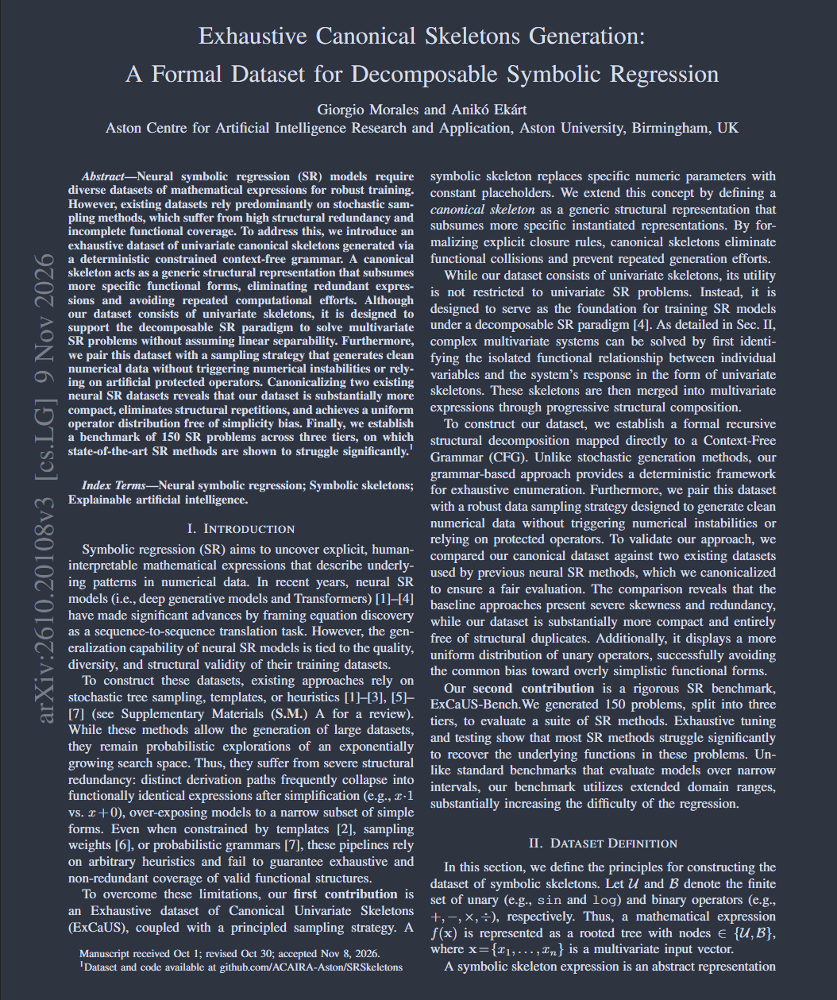

That's right! We published a journal paper for you, fine people working on or interested in Symbolic Regression. 🚀

Our paper, "[Exhaustive Canonical Skeletons Generation: A Formal Dataset for Decomposable Symbolic Regression](publication/morales-2026-ieeeciletters/)," coauthored with Dr [Aniko Ekart](https://research.aston.ac.uk/en/persons/aniko-ek%C3%A1rt/), has just been accepted for publication at [IEEE Computational Intelligence Letters](https://cis.ieee.org/publications/ieee-computational-intelligence-letters), a new journal of the [IEEE Computational Intelligence Society](https://cis.ieee.org/).

Most dataset generation for training Transformer models for Neural SR relies on random sampling, which creates significant structural redundancy and incomplete functional coverage. To address this, we created ExCaUS: an exhaustive dataset of canonical "skeleton" expressions generated via a deterministic, constrained context-free grammar. These canonical skeletons subsume more specific functional forms, eliminating redundant expressions and avoiding repeated computational efforts. We also paired it with a numerical data sampling strategy that avoids numerical instabilities without needing artificial protected operators. Finally, to put SR algorithms to the test, we're introducing ExCAUS-Bench, a rigorous 150-problem benchmark where current state-of-the-art methods still significantly struggle!

Check out the links below to learn more: 

📄 **Read the (extended) paper**: https://arxiv.org/pdf/2610.20108

🛠️ **ExCaUS dataset**: https://github.com/ACAIRA-Aston/SRSkeletons

📊 **ExCAUS-Bench benchmark**: https://github.com/ACAIRA-Aston/UnivariateSRBenchmark

<figure style="display: flex; flex-direction: column; align-items: center;">
    
    <figcaption style="text-align: center; margin-top: 5px; font-style: italic;">
        Paper preview.
    </figcaption>
</figure>
